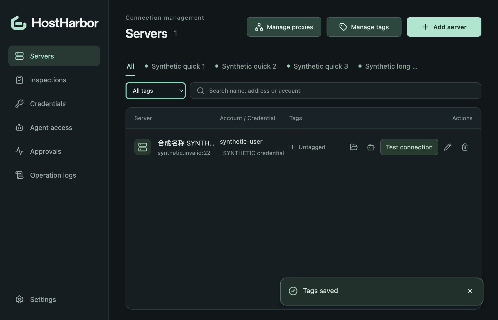
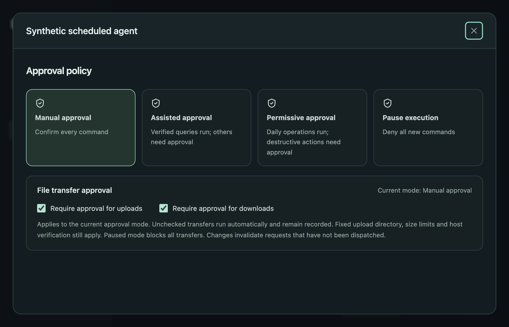
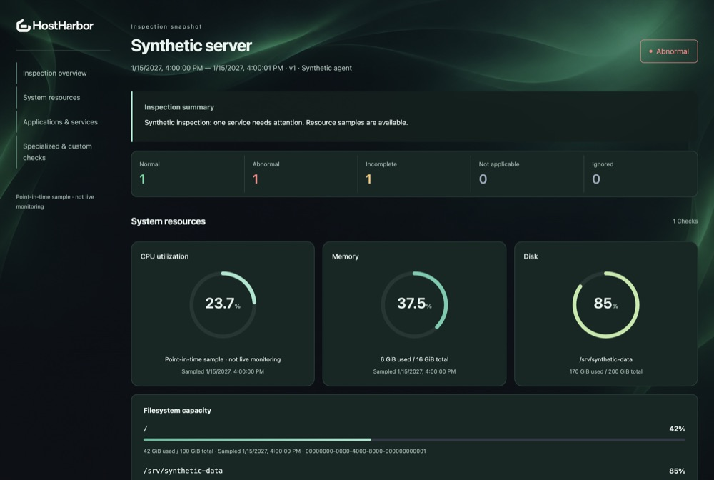

<picture>
  <source media="(prefers-color-scheme: dark)" srcset="resources/branding/lockup-light.svg">
  
</picture>

**A local approval and monitoring layer between AI agents and your servers.**

[简体中文](README.zh-CN.md) · [Downloads](https://github.com/haos666/hostharbor/releases) · [MCP setup](docs/mcp.md) · [Security](SECURITY.md)

HostHarbor is a local desktop workspace that connects AI agents to your SSH servers through MCP. Keep SSH credentials on your computer, give each agent a scoped MCP connection, review execution and file transfers, and turn routine inspections into versioned reports and offline dashboards. Built for personal server management.

## Built for everyday server work

- **Manage access locally.** Save SSH passwords or private keys, pin host fingerprints, and connect directly, through an SSH jump host, or through SOCKS5. Choose a saved shared SOCKS5 proxy and update it once for all linked servers. Bind a separate sudo credential when needed; import a private key by file, pasted content or path, including hidden directories.
- **Give each agent its own access.** Create scoped, expiring or permanent MCP profiles with independent tokens. Search servers and select matching results in bulk. Edit grants or revoke an access profile without handing the agent your SSH password or private key.
- **Choose approval per access.** Configure command modes, risk rules, AI advice and upload/download approval separately for each agent. Two global switches can require approval everywhere or deny new execution.
- **See what happened.** Use the approval center for pending/running operations and searchable history for finished operations. Replay recorded text output, with configurable retention and local storage limits.
- **Transfer files without another tool.** Browse remote metadata and transfer single files over SFTP. Uploads use a fixed server directory and configurable size limits, with phase progress, separate timeout controls, and optional full readback verification.
- **Give agents useful server context.** Optional AI investigations create structured, editable server and application dossiers. MCP tools can find applications and query maintained log entries instead of rediscovering deployment paths every time.
- **Back up your assets.** Export password-encrypted `.hhbackup` files, preview conflicts and restore selected assets without overwriting existing data. [Backup guide](docs/backup.md).
- **Organize your servers.** Create colored tags, assign multiple tags per server, and pin up to four quick filters alongside the full tag dropdown and search. [Tags](docs/server-tags.md) · [Shared proxies](docs/shared-proxies.md).
- **Maintain repeatable inspections.** A dedicated, report-first workspace keeps editable Markdown checklists, optional AI analysis and versioned agent reports together. Start with a template or write your own checks; scheduling stays with your external agent. [Inspection guide](docs/inspections.md).
- **Read, visualize and export reports.** Read Markdown inside the app, open an offline HTML dashboard in your browser, or export Markdown, Word and HTML. Reports can show sampled CPU, memory and disk metrics, followed by application and custom checks. Four complete themes change charts, layout and background.
- **Review exceptions.** Ignore or restore a finding in the current report and recalculate its result. For future runs, review an AI-drafted note of up to 50 characters before appending it to the checklist; nothing silently changes the plan.
- **Use your preferred language.** Follow the system language, or choose Simplified Chinese or English. Settings are grouped into General, Security, and Data & integrations.



## Download for macOS

The current distribution targets **macOS only**. Choose the architecture that matches your Mac.

| Mac | Download |
| --- | --- |
| Apple Silicon — M series | [arm64 installer](https://github.com/haos666/hostharbor/releases/download/v0.3.0/HostHarbor-0.3.0-mac-arm64.dmg) |
| Intel | [x64 installer](https://github.com/haos666/hostharbor/releases/download/v0.3.0/HostHarbor-0.3.0-mac-x64.dmg) |

ZIP archives and SHA-256 checksums are available on the [release page](https://github.com/haos666/hostharbor/releases/tag/v0.3.0). These binaries are **not Developer ID signed or notarized**; macOS may block opening them. Review the release notes and verify the checksum before choosing whether to open the application through macOS security settings. Do not disable Gatekeeper globally.

Windows installers are deferred to a later release. Source code for Windows is not a promise of current Windows release support.

Built-in server investigations and diagnostic probes currently target Linux servers. Other remote systems have not received equivalent feature validation; submitted commands must match the remote shell.

## Connect your first agent

1. Open HostHarbor and create an app lock password and recovery code. Preserve the recovery code separately.
2. Add a credential and a server. Bind the credential, test the connection, and verify the displayed host fingerprint independently before trusting it.
3. In **Agent access**, create an access profile for the intended servers and copy its installation configuration.
4. Enable the local MCP service and install that configuration in your MCP client. It contains a bearer token: treat it as a credential.
5. Configure the access profile’s command and file approval policy. Use Settings for the global require-approval and deny-execution switches. Pending operations appear in **Approvals**, and finished operations appear in **Operation logs**.

HostHarbor uses authenticated **Streamable HTTP on loopback**. The app and MCP client run on the same computer. Your normal VPN connectivity still applies. See [MCP setup](docs/mcp.md), [SSH routing](docs/ssh-routing.md), and the in-app tool catalog for details.



## Local storage and optional AI

Credentials and API keys are encrypted locally; HostHarbor does not upload your SSH credentials to an AI provider. Some asset metadata remains plaintext in the local database. An MCP client can see authorized operation output, which may contain sensitive business data.

AI is optional. Configure an OpenAI-compatible or Anthropic-compatible endpoint, API key, and model in Settings. Starting a server investigation sends selected, filtered server information to that configured endpoint. Review the provider and data scope before starting; filtering cannot guarantee that all sensitive content is removed. See [AI settings](docs/ai-settings.md) and [server dossiers](docs/server-dossier.md).

## Understand the boundary

Approval rules and AI advice do not make arbitrary shell commands safe or read-only. Permissive mode is an explicit choice to allow routine operations by default. Remote commands inherit the SSH account's permissions. Disconnecting SSH does not prove that a remote process stopped; uncertain outcomes are not automatically retried.

Local activity records are not tamper-proof enterprise audit logs. The vault does not protect against every compromised-OS or same-user attack. Automatic updates, resumable transfers and recursive directory synchronization are not included. Read [SECURITY.md](SECURITY.md) before connecting important assets.

## v0.3.0 update

This update brings the pending backup and per-access approval work together with standalone inspections, structured dashboards and report review, shared proxies, colored tags and a more consistent desktop interface. See the [bilingual release and upgrade notes](docs/releases/v0.3.0.md) and [changelog](CHANGELOG.md).



**v0.3.0 is available for macOS Apple Silicon and Intel**, with DMG, ZIP and per-architecture SHA-256 checksums on the [release page](https://github.com/haos666/hostharbor/releases/tag/v0.3.0). Both architectures passed [release CI](https://github.com/haos666/hostharbor/actions/runs/44703013580).

Current source uses schema15: preserve a pre-upgrade app-data copy for rollback. Existing reports without metrics remain readable and show missing measurements as unavailable. Reconnect MCP clients to refresh their tool schema. Windows distribution remains deferred.

## Build and contribute

Requires Node.js 24.15+ (supported engine range in `package.json`), npm, and macOS for current native release validation.

```sh
npm ci
npm run dev
```

```sh
npm run check
npm run test:native
npm run dist:mac:arm64
# On an Intel Mac:
npm run dist:mac:x64
```

[Contributing](CONTRIBUTING.md) · [Architecture](docs/architecture.md) · [Changelog](CHANGELOG.md)

## License

HostHarbor is licensed under [Apache-2.0](LICENSE). Dependencies retain their own licenses; see [third-party notices](THIRD_PARTY_NOTICES.md). The license does not grant rights to the HostHarbor trademarks.
