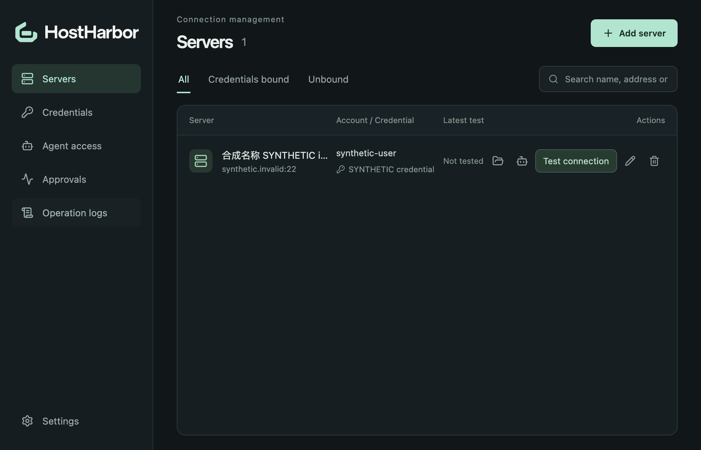
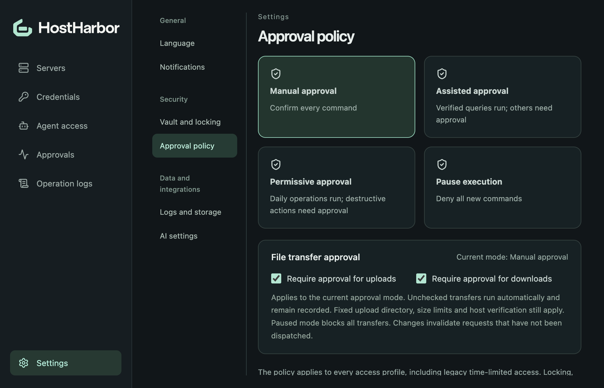

<picture>
  <source media="(prefers-color-scheme: dark)" srcset="resources/branding/lockup-light.svg">
  
</picture>

**自己的服务器，自己的凭证，让智能体通过受控入口完成运维。**

[English](README.md) · [下载](https://github.com/haos666/hostharbor/releases) · [MCP 接入](docs/mcp.md) · [安全说明](SECURITY.md)

HostHarbor 是一个运行在本机的服务器工作台。它集中管理 SSH 凭证，通过本地 MCP 向智能体开放指定服务器，并把授权、审批、执行结果和操作回放放在同一个桌面客户端里。

## 为日常服务器工作准备

- **本地管理凭证与连接。** 支持密码、SSH 私钥、主机指纹确认，以及直连、SSH 跳板、SOCKS5。需要提权时可绑定独立 sudo 凭证。
- **给每个智能体独立授权。** 按接入配置服务器范围、有效期和独立 Token，随时修改或撤销，无需把 SSH 密码或私钥交给智能体。
- **按自己的习惯审批。** 可选全部审批、辅助审批、显式开启的宽松审批或暂停执行。每种模式分别设置上传和下载是否需要审批。
- **看清执行过程和结果。** 审批中心处理待审批、执行中的操作；操作日志支持筛选、分页和文本输出回放，可设置保留时间与本地空间上限。
- **直接传输文件。** 通过 SFTP 浏览远端目录元数据、上传和下载单个文件。固定上传目录、文件大小上限、分阶段进度、独立超时与可选完整读回校验一并提供。
- **让智能体理解服务器。** 可选 AI 调查将系统资源、运行服务和部署信息整理成结构化档案；人工可维护应用别名、部署目录和日志入口，智能体无需每次从头寻找。
- **中英文随时切换。** 默认跟随系统，也可选择简体中文或 English；设置按常规、安全、数据与集成分类。



## 下载 macOS 版本

本次仅提供 **macOS** 安装包，请按设备架构选择。

| Mac 类型 | 下载 |
| --- | --- |
| Apple Silicon（M 系列） | [arm64 安装包](https://github.com/haos666/hostharbor/releases/download/v0.1.0/HostHarbor-0.1.0-mac-arm64.dmg) |
| Intel | [x64 安装包](https://github.com/haos666/hostharbor/releases/download/v0.1.0/HostHarbor-0.1.0-mac-x64.dmg) |

[发布页](https://github.com/haos666/hostharbor/releases/tag/v0.1.0)同时提供 ZIP 和 SHA-256 校验文件。首批安装包**尚未完成 Developer ID 签名及公证**，macOS 可能阻止打开。请先核对来源、发布说明和校验值，再自行决定是否通过系统安全设置打开；不要全局关闭 Gatekeeper。

Windows 安装包留到后续版本；仓库保留 Windows 相关代码，不代表本次已经完成 Windows 发布验收。

当前内置服务器调查和诊断采集主要面向 Linux 服务器；其他远端系统尚未完成同等功能验证，提交的命令需要符合远端 Shell。

## 第一次接入智能体

1. 启动应用，设置加锁密码和恢复码，单独妥善保存恢复码。
2. 添加凭证与服务器并绑定，测试连接；首次信任主机前，通过独立渠道核对显示的指纹。
3. 在“智能体接入”创建接入，选定服务器，复制安装配置。
4. 开启本地 MCP 服务，将配置安装到智能体客户端。配置含有接入 Token，请像密码一样保护。
5. 在设置中选择审批方式。待处理请求在“审批中心”，已结束记录在“操作日志”。

MCP 使用带认证的本机回环 **Streamable HTTP**。应用和智能体客户端运行在同一台电脑上，服务器是否可达仍取决于本机网络及 VPN。详见 [MCP 接入](docs/mcp.md)、[SSH 路由](docs/ssh-routing.md)及应用内工具列表。



## 本地存储与可选 AI

凭证和 API Key 在本机加密保存；HostHarbor 不会把 SSH 凭证上传给 AI。部分资产元数据仍以明文保存在本机数据库中。智能体可以读取获授权操作的输出，其中可能包含业务敏感内容。

AI 不是使用前提。可在设置中配置 OpenAI 兼容或 Anthropic 兼容地址、Key 与模型。主动启动服务器调查后，选定并经过过滤的服务器信息会发往该地址；过滤不能保证识别所有敏感信息，请先核对服务提供方和数据范围。详见 [AI 配置](docs/ai-settings.md)及[服务器档案](docs/server-dossier.md)。

## 使用边界

审批规则和 AI 建议不能保证任意 Shell 命令安全或只读。宽松审批是用户主动选择的默认执行授权；命令拥有远端登录账号的权限。断开 SSH 不代表远端进程已停止，结果不确定时不会自动重试。

本地操作记录不是不可篡改的企业审计系统；凭证库也无法防御所有同账号或系统被攻破的情况。本版不含便携凭证库导出、自动更新、断点续传或递归目录同步。连接重要资产前，请阅读 [SECURITY.md](SECURITY.md)。

## 开发与贡献

需要 Node.js 24.15+（具体范围见 `package.json`）、npm；当前原生发布验收以 macOS 为准。

```sh
npm ci
npm run dev
```

```sh
npm run check
npm run test:native
npm run dist:mac:arm64
# 在 Intel Mac 上构建：
npm run dist:mac:x64
```

[贡献说明](CONTRIBUTING.md) · [架构](docs/architecture.md) · [更新记录](CHANGELOG.md)

## 开源协议

采用 [Apache-2.0](LICENSE)。依赖组件保留各自许可证，见[第三方声明](THIRD_PARTY_NOTICES.md)；许可证不授予 HostHarbor 商标权利。
