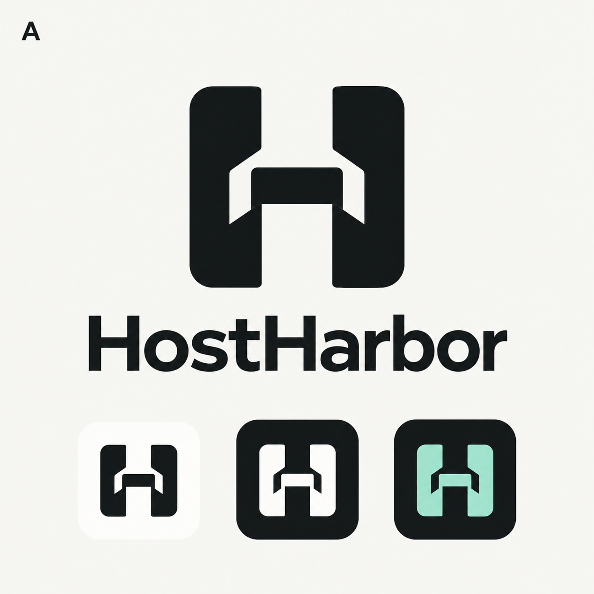
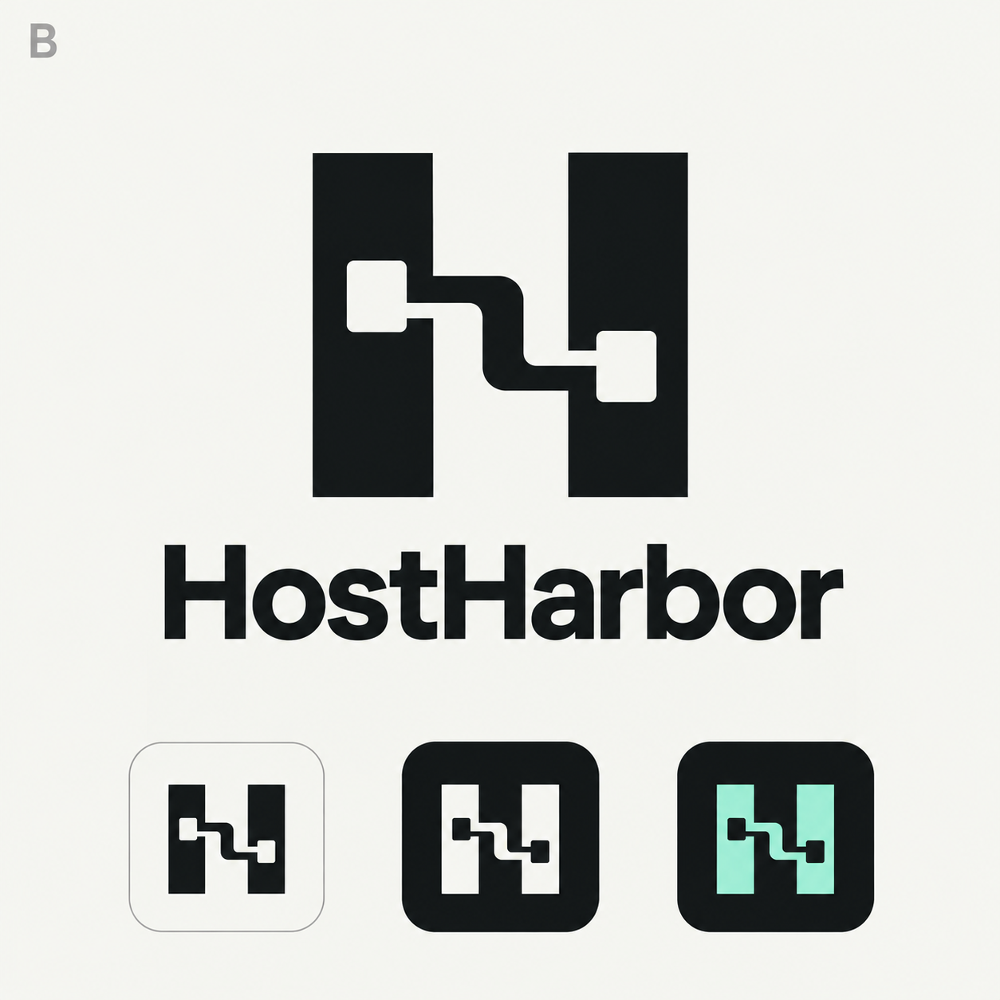
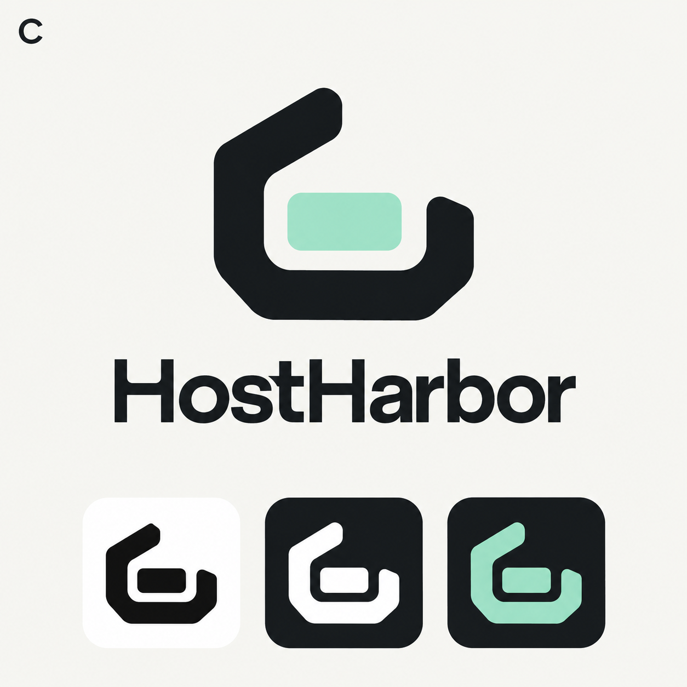

# HostHarbor 品牌设计档案

日期：2026-10-22。完整保存本次三个概念方向，供官网、发布说明和品牌延展复用。概念PNG保持原样；当前产品使用下方规范化SVG和图标导出，而非展示板裁剪。

## 概念图

| 方案 | 方向 | 原始完整图 | 选择 |
| --- | --- | --- | --- |
| A | 港湾 H：港口入口与H字母结合 | [logo-a-harbor-h.png](concepts/logo-a-harbor-h.png) | 保留探索稿 |
| B | 连接 H：连接节点与H字母结合 | [logo-b-connected-h.png](concepts/logo-b-connected-h.png) | 保留探索稿 |
| C | 几何泊位：开放港湾与内部停靠模块 | [logo-c-dock.png](concepts/logo-c-dock.png) | 用户选定 |

## 已选规范

- 应用图标：用户指定的 [白色标志/深底版本](references/selected-white-app-icon.png)。整体背景在1024画布中占848像素，四周88像素透明留白，相比上一版928像素边长缩小约8.6%；内部符号按白色参考比例绘制。
- 字标：沿用 [概念字标参考](references/selected-wordmark.png)，从原始C图中的字形固化平滑矢量轮廓，不再依赖macOS/Windows系统字体。字标为图形路径，网站使用时保留可访问名称 HostHarbor。
- 侧栏：薄荷绿标志 + 浅色字标；菜单栏为系统着色单色模板。
- 调色：薄荷绿 `#A2E7CD`、石墨 `#101619`、浅色 `#F4F5F1`、应用符号白 `#FFFFFF`。

## 官网可直接复用

资源位于 [resources/branding](../../../resources/branding/README.md)：

- 独立符号：`mark.svg`（薄荷绿）、`mark-light.svg`、`mark-dark.svg`。
- 独立字标：`wordmark.svg`（轮廓源）、`wordmark-light.svg`、`wordmark-dark.svg`。
- 横排组合：`lockup-light.svg` / `lockup-dark.svg`，适合网站导航。
- 竖排组合：`lockup-stacked-light.svg` / `lockup-stacked-dark.svg`，适合Hero、发布图。
- 应用图标：`app-icon.svg`、1024px PNG、ICNS、ICO。

浅色版本用于深色背景，深色版本用于浅色背景；保持viewBox和宽高比，不把展示板背景当作透明素材。PNG概念档案不会被桌面打包配置包含。

## 设计意图记录

三个方向共用简洁、几何、开发者桌面工具的定位，探索薄荷绿/深石墨/黑白表现。每张展示板含主标志、HostHarbor字标和黑白/深底小图标。最终选择C，后续明确采用白色深底应用图标、增加Dock留白，以及匹配原概念字形的轮廓字标。
